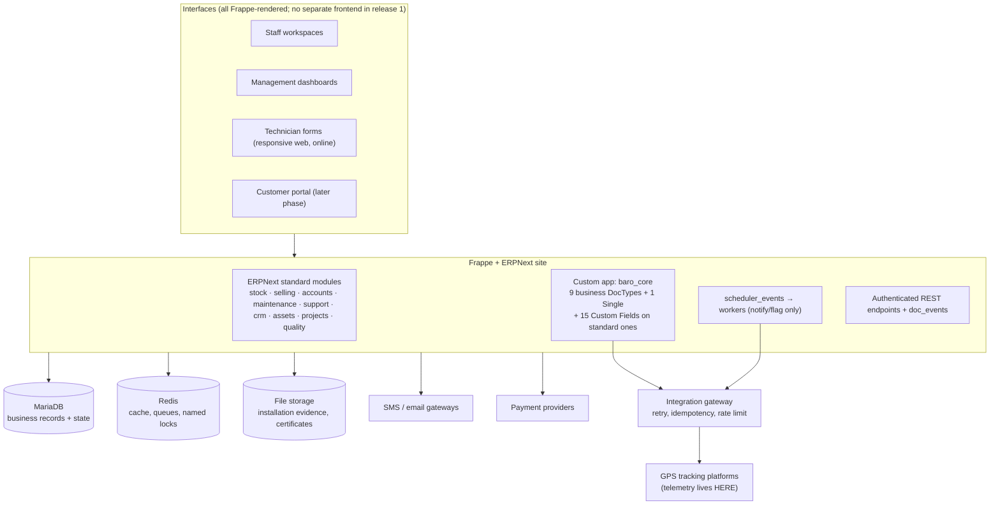

# 01 — Architecture Overview

BARO Group ERP 360° · target **ERPNext v16 stable + Frappe v16** · first release = **asset spine**
Status: proposed for stakeholder approval. Every claim about a standard DocType in this package carries a `[verify-vs-v16]` tag where it was read from a newer source tree (see `04-version-compatibility-matrix.md`).

## 1. Purpose

Turn ERPNext into BARO Group's operating system for a GPS-tracking, speed-limiter, vehicle-technology, installation and technical-service business. This package is the **design** phase output: data model, module boundaries, permissions, workflows and integration contracts, approved before any Frappe app code is written.

## 2. Release-1 boundary — the asset spine

Release 1 delivers reliable records for: **customers, inventory/warehouse, GPS devices, SIM cards, vehicles, device assignments, installations.** Everything else in the two source blueprints (24 workspaces, helpdesk, HR/payroll, AI assistant, customer portal, mobile offline, advanced BI) is explicitly deferred to `90-later-phase-backlog.md`.

The spine is worth building first because it is the only part of BARO's business that generic ERPNext does not model, and because every later module hangs off it:

```
Customer ─< Baro Vehicle ─< Baro Device Assignment >─ Serial No (the device)
                                        │                    >─ Baro SIM Card
                                        └─< Installation Note (selling)
Customer ─< Contract (crm) ─< Subscription (accounts) ─< Sales Invoice
```

Contracts, subscriptions and billing **already exist** in ERPNext. Release 1 must not rebuild them; it must produce the device/vehicle/SIM records that later feed them correctly.

### 2.1 The reference end-to-end journey

The consolidated blueprint defines an 11-step journey: CRM request → quotation/approval/contract → **stock reserve device + SIM** → **dispatch technician + appointment** → installation with evidence and signature → quality inspection/approval → fleet link device/SIM/vehicle → platform activation verification → service plan activation and recurring invoice → helpdesk → management KPIs.

Two of those steps change the spine design and are captured here:

- **Reservation is a device state, not a document.** A device earmarked for a customer order must be distinguishable from one freely in stock. Release 1 models this as `Reserved` in the device lifecycle (`40-workflows-approvals.md` §2), sourced from an open Sales Order / un-issued Delivery Note rather than a new BARO doctype. Note: `Delivery Note` already carries `per_installed` and `installation_status` `[verify-vs-v16]`, so installation progress is natively linked to dispatch. A dedicated `Reserved Stock` doctype is **absent** from the downloaded source tree — the design must not depend on it existing in v16.
- **Dispatch reuses scheduling, not custom doctypes.** Step 4 maps onto `Appointment` (`crm/doctype/appointment`: `scheduled_time, calendar_event, appointment_with, party, status`) plus `Appointment Booking Settings`, and `Calendar Event` which is Frappe core. Technician calendars are therefore standard records that a later Scheduling & Dispatch workspace reads; release 1 only needs `Baro Device Assignment` to be able to carry an optional appointment link.

## 2.2 Sources for this package

| Source | Content used |
|---|---|
| `BARO_Group_ERP360_Complete_Development_Plan.pdf` (consolidated blueprint, Oct 2026) | Vision, 24-workspace directory, the 11 supplied ERP menu modules with detailed requirements, smart-productivity feature list, 11-step journey |
| Original 18-module / 8-phase blueprint text | Module inventory, standard-vs-custom intent, automation trigger list, technical standards table, dashboard and security requirements, roadmap |
| Revised blueprint text | 24 workspaces, proposed six-app layout, department→workspace access table, build order |
| `C:\Users\Lenovo\Desktop\Erp system\erpnext-develop.zip` | Every standard-DocType field claim in this package, spot-checkable per `appendix/spot-check-paths.md` |

Where a source conflicts with the ERPNext code, **the code wins** and the conflict is recorded in `04-version-compatibility-matrix.md`.


## 3. System context



### Layer responsibilities

| Layer | Owner | Notes |
|---|---|---|
| Identity, RBAC, workflow engine, queues, file storage | Frappe | Do not reimplement. |
| Stock, serial numbers, invoicing, subscriptions, SLA, quality, projects, CRM | ERPNext standard | Reuse or extend via Custom Field / Property Setter only. |
| Vehicle, assignment time-series, SIM, platform mapping, firmware, RMA, integration log, reconciliation exception, platform master, operations settings | Custom `baro_core` | The only net-new schema in release 1. |
| Telemetry (track points, speed, ignition, DTC history) | **External GPS platform / TSDB** | See §5. Firm boundary. |

## 4. Governing principle: extend, do not duplicate

ERPNext already models device identity (`Serial No`), installation (`Installation Note`), warranty (`Warranty Claim`), inspection (`Quality Inspection`), service visits (`Maintenance Visit`), support tickets with SLA (`Issue`), agreements (`Contract`) and recurring billing (`Subscription`, 40 fields incl. plan rows and billing windows).

Where a blueprint proposes a `BARO Device`, `BARO Installation` or `BARO Service Inspection` DocType, this design **rejects it** and extends the standard record instead. Two parallel records for one real object fork stock and ledger truth, break picklists and reconciliation reports, and cannot be merged later without a data migration. Full reasoning and per-entity verdicts: `03-standard-vs-custom-decision-table.md`.

## 5. Data boundary rule — no telemetry in the ERP

ERPNext stores **state and milestones only**: is the device active, last communication timestamp, which vehicle/customer it is assigned to, discrete service events. High-frequency positional and canbus time-series stays in the tracking platform or a dedicated time-series store.

Row-per-GPS-point DocTypes would destroy Frappe performance, backup size, and restore time, because every record is a metadata-bound document with permissions and versioning. This constraint is a hard requirement, not an optimisation: it is what keeps `Baro Integration Log` append-only and bounded, and keeps the daily reconciliation cheap.

## 6. Security and control posture

Enforcement is **server-side**. Client scripts are cosmetic and are labelled non-enforcing wherever they appear in this package.

- Role-based + record-level access (`User Permissions` for branch/warehouse/customer; Permission Query Conditions per role).
- Maker-checker on service-impacting and financial documents (submittable DocTypes + Workflow approval transitions; no self-approval).
- Automated jobs **notify or flag only**. Suspending tracking, changing billing, or terminating a customer requires an approved human transition. This is BARO's own stated invariant and it is carried through `40-workflows-approvals.md` and `60-automation-trigger-catalog.md`.
- Audit trail on financial changes, device replacements and customer status changes.
- Secrets held in Frappe's encrypted `Password` fields, never in DocType Data fields; per-platform integration credentials belong on `Baro GPS Platform` (one row per platform, `10` §4.8), never in a Single or a fixture.

## 7. Ethiopian compliance gate

VAT, withholding, e-Treasury/FRC invoice formats, ETB rounding and payroll rules are **not** assumed anywhere in this package. They are listed as blocking stakeholder questions in `70-open-questions-stakeholders.md` and must be validated with BARO finance and legal before production deployment. Nothing in the asset spine depends on them, which is part of why the spine is the right first release.

## 8. Reading order for approvers

| Order | Document | Decides |
|---|---|---|
| 1 | `02-app-boundary-decision.md` | One custom app, not six |
| 2 | `03-standard-vs-custom-decision-table.md` | Reuse / extend / build per entity |
| 3 | `04-version-compatibility-matrix.md` | Version pins and verification debt |
| 4 | `10`, `11` | Data dictionary and ERD |
| 5 | `20`, `21` | Module spec, custom DocType fields |
| 6 | `30`, `31` | Schema conventions, uniqueness and concurrency |
| 7 | `40`, `41` | Workflows/approvals, roles and permissions |
| 8 | `50`, `51` | GPS integration contract, reconciliation |
| 9 | `60` | Automation trigger traceability |
| 10 | `70` | What BARO must decide before build starts |
| 11 | `90` | What is deliberately not in release 1 |
| 12 | `80` | Verification results (defects listed here) |
| — | `appendix/spot-check-paths.md` | How to re-check any standard-DocType claim against the source |

## 9. Non-goals of release 1

New frontend framework · mobile offline sync · AI assistant · customer/supplier portals · HR and payroll · manufacturing · separate helpdesk app · multi-currency beyond ETB reporting · BI warehouse. See `90-later-phase-backlog.md` for the conditions that unlock each.

## 10. Glossary

| Term | Meaning |
|---|---|
| Device | A physical GPS modem/speed-limiter unit; represented by a `Serial No` record extended with `baro_*` fields |
| IMEI | 15-digit device identifier; uniqueness and no-duplicate-active-assignment are BARO's headline acceptance criteria |
| Assignment | Time-bounded link of device (and optionally SIM) to a vehicle and customer; the spine's central record |
| ICCID / MSISDN | SIM identifiers; `ICCID` is the unique key for a SIM record |
| Platform | An external GPS tracking system holding telemetry and its own device id namespace |
| Platform Mapping | Serial No ↔ platform device id, per platform; the reconciliation join key |
| Maker / Checker | Creator of a document vs the person who submits/approves it; must differ |
