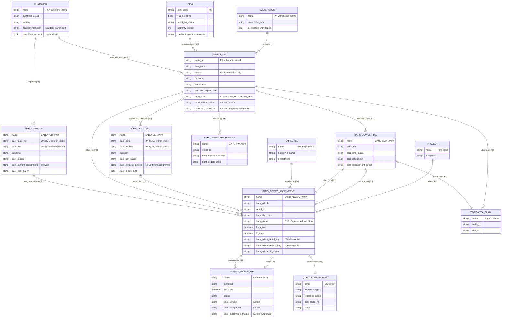
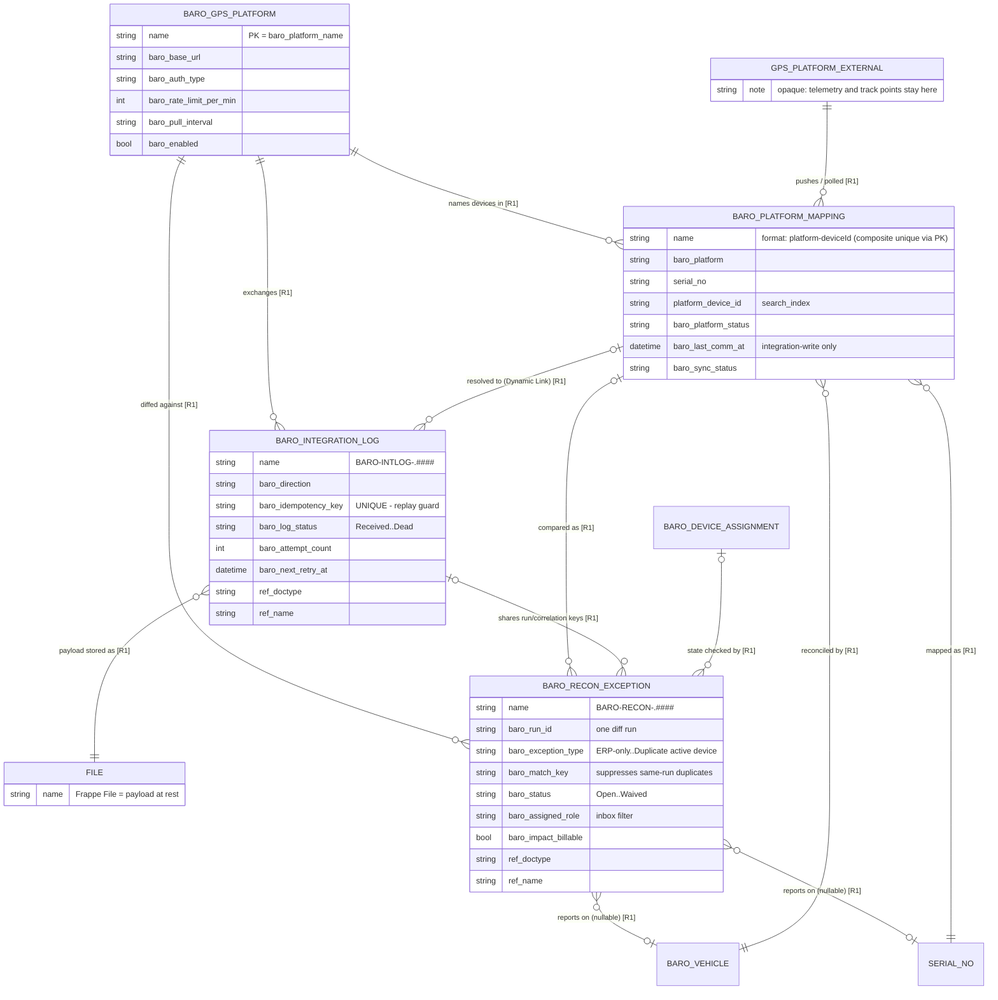
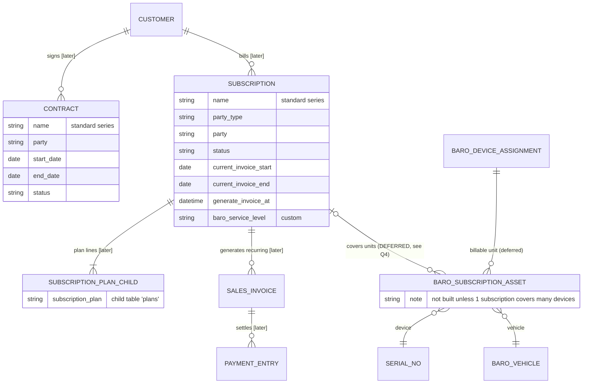

# 11 — Entity Relationship Diagrams

**How to view:** each block below is Mermaid `erDiagram`. It renders in GitHub, VS Code (Markdown preview with Mermaid), Obsidian and Qoder's markdown preview with no installation — chosen deliberately because this machine has no Java/Python runtime for PlantUML. Entity names use `SNAKE_UPPER`; the real Frappe DocType name is in the label mapping (§5).

Relations tagged **[R1]** are release-1 (asset spine). **[later]** marks entities that exist in ERPNext but are not built out yet — they appear here so the spine does not paint itself into a corner.

## 1. The asset spine

## 2. Integration boundary

## 3. Billing boundary (reuse only — no new schema in release 1)

## 4. Cardinality and authority rules

These are the constraints a reviewer should actually check; enforcement mechanisms live in `31-uniqueness-concurrency-design.md`.

| # | Rule | Cardinality | Authority (who may write) | Mechanism |
|---|---|---|---|---|
| R-01 | A Customer owns many Vehicles | 1:M | Sales/Fleet | `Baro Vehicle.customer` REQ Link |
| R-02 | A Vehicle may have **at most one Active** assignment | 1:0..1 active | Field Service via submit | `baro_active_vehicle_key` **UQ-DRV** |
| R-03 | A Device (Serial No) may have **at most one Active** assignment | 1:0..1 active | Field Service via submit | `baro_active_serial_key` **UQ-DRV** |
| R-04 | Assignments never overwrite history; they end or are superseded | append | Field Service + Approver | submittable + Workflow + `to_time` OS |
| R-05 | No two Active assignments may overlap in time on the same device | — | `before_submit` | Datetime-range query + Redis lock + `SELECT … FOR UPDATE` |
| R-06 | IMEI is unique across all devices | 1:1 | Stock Manager | `Serial No.baro_imei` **UQ** |
| R-07 | ICCID and MSISDN are each unique per SIM | 1:1 | Connectivity Admin | `baro_iccid` / `baro_msisdn` **UQ** |
| R-08 | A plate number identifies exactly one vehicle record | 1:1 | Fleet | `baro_plate_no` **UQ** |
| R-09 | A device's current SIM is derived, never typed | derived | Assignment `on_submit` | `Baro SIM Card.baro_installed_device` RO/DRV |
| R-10 | One platform device id maps to one serial per platform | 1:1 per platform | Integration | `autoname: format:{baro_platform}-{platform_device_id}` |
| R-11 | One integration event is processed once | 1:1 | Integration | `baro_idempotency_key` **UQ** |
| R-12 | Firmware history is append-only | 1:M | Integration + Stock Manager | no-delete permission, RO fields |
| R-13 | An RMA that replaces a device ends the old assignment and starts a new one | 1:1 pairs | Service Supervisor | `baro_old_assignment` / `baro_new_assignment` DRV |
| R-14 | Installation evidence attaches to the standard note, not a BARO copy | M:1 | Installer | `Installation Note` custom fields |
| R-15 | Every assignment belongs to exactly one Customer, consistent with its Vehicle | — | Validation | cross-check in `validate` |
| R-16 | A reconciliation exception references at least one of serial / vehicle / mapping, and never writes to them | M:0..1 | Job creates; named roles close | `validate` requires one reference + no `doc_events` on this DocType (`51` §7) |

## 5. Label mapping (Mermaid entity → Frappe DocType)

| Diagram entity | DocType | Module | New? |
|---|---|---|---|
| `CUSTOMER` | Customer | selling (ERPNext) | standard |
| `ITEM`, `WAREHOUSE`, `SERIAL_NO`, `QUALITY_INSPECTION` | Item, Warehouse, Serial No, Quality Inspection | stock (ERPNext) | standard + custom fields |
| `INSTALLATION_NOTE` | Installation Note (+ Installation Note Item) | selling (ERPNext) | standard + custom fields |
| `WARRANTY_CLAIM` | Warranty Claim | support (ERPNext) | standard |
| `SUBSCRIPTION`, `SALES_INVOICE`, `PAYMENT_ENTRY`, `SUBSCRIPTION_PLAN_CHILD` | Subscription, Sales Invoice, Payment Entry, Subscription Plan child | accounts (ERPNext) | standard |
| `CONTRACT` | Contract | crm (ERPNext) | standard |
| `PROJECT`, `TASK` | Project, Task | projects (ERPNext) | standard |
| `EMPLOYEE` | Employee | setup (ERPNext) / hrms | standard (partial) |
| `BARO_VEHICLE` | **Baro Vehicle** | baro_fleet | new |
| `BARO_DEVICE_ASSIGNMENT` | **Baro Device Assignment** | baro_field_service | new |
| `BARO_SIM_CARD` | **Baro SIM Card** | baro_connectivity | new |
| `BARO_FIRMWARE_HISTORY` | **Baro Firmware History** | baro_devices | new |
| `BARO_DEVICE_RMA` | **Baro Device RMA** | baro_devices | new |
| `BARO_PLATFORM_MAPPING` | **Baro Platform Mapping** | baro_integrations | new |
| `BARO_INTEGRATION_LOG` | **Baro Integration Log** | baro_integrations | new |
| `BARO_RECON_EXCEPTION` | **Baro Reconciliation Exception** | baro_integrations | new |
| `BARO_GPS_PLATFORM` | **Baro GPS Platform** | baro_settings | new |
| `BARO_SUBSCRIPTION_ASSET` | *Baro Subscription Asset* | baro_billing | **deferred** (Q4) |
| `FILE`, `CALENDAR_EVENT` | File, Calendar Event | frappe core | standard |
| `GPS_PLATFORM_EXTERNAL` | (no DocType) external system | — | out of ERP |

## 6. Deliberate absences

- **No telemetry entity.** Track points, speed and ignition history are not modelled at all (`01` §5). Only `baro_last_comm_at` and a platform status enum cross the boundary.
- **No `BARO Device`, `BARO Installation`, `BARO Service Inspection`, `BARO Contract`, `BARO Invoice`** — each would fork a fact ERPNext already owns (`03` §6).
- **No customer-portal or claims entities** — later phase (`90`).
