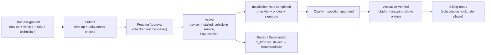

# 20 — Module Specification: Asset Spine (Release 1)

Functional spec for the six areas that make up release 1. Field definitions are in `10-data-dictionary.md` (never duplicated here); DocType behaviour is in `21-custom-doctype-fields.md`.

## 0. Actors

| Actor | Departments | Primary areas |
|---|---|---|
| Sales Officer | Sales | A1 |
| Storekeeper | Warehouse | A2, A6 |
| Stock Manager | Warehouse | A2, A6, approves device state |
| Fleet Officer | Technical/Fleet | A3 |
| Installer / Technician | Technical | A4 |
| Service Supervisor | Technical | A4, A5 (checker) |
| Connectivity Admin | Technical/SIM | A5 |
| Support Agent | Customer Care | A6 |
| Finance | Finance | read-only across spine; owns billing hooks |
| Integrator (bot) | IT | A2 last-comm, platform mapping, logs |
| System Manager | IT | configuration, roles, imports |

## A1 — Customer & fleet accounts

**Standard only:** `Customer`, `Contact`, `Address`, `Customer Group`, `Territory`. Custom fields: `baro_fleet_account`, `baro_platform_customer_ref`.

| Item | Spec |
|---|---|
| Purpose | One trusted customer record that owns vehicles, devices, SIMs and (later) contracts |
| Screens | Customer list + Customer 360 view (§7) |
| Key behaviour | `account_manager` (standard field) is the responsible-officer field — **do not add a BARO owner field**. `baro_fleet_account` flags multi-vehicle accounts and defaults portal/scheduling behaviour later |
| Invariants | No duplicate customer on `tax_id` or `customer_name` (ERPNext duplicate-check + `Customer` duplicate detection feature); `on_hold`/`is_frozen` (standard) block transactions, and must also block new assignments (server check in `Baro Device Assignment.validate`) |
| Import | Template `baro_customers.csv` (§8) |

## A2 — Device inventory (GPS, speed limiters, sensors, accessories)

**Standard:** `Item` (with `has_serial_no`, `serial_no_series`, `warranty_period`, `barcodes`, `quality_inspection_template`, `safety_stock`, `reorder_levels`, `inspection_required_before_delivery`), `Warehouse` (incl. `is_rejected_warehouse`, `warehouse_type`), `Serial No`, `Serial and Batch Bundle`, `Stock Entry`, `Delivery Note`, `Purchase Receipt`.
**Custom fields on `Serial No`:** `baro_imei`, `baro_device_status`, `baro_firmware_version`, `baro_last_comm_at`.

| Step | Record | Effect |
|---|---|---|
| Purchase GPS devices | `Purchase Order` → `Purchase Receipt` (serial numbers captured, `Quality Inspection` if the Item requires inspection on delivery) | Serial No created, stock balance + valuation update |
| Register IMEI | Edit `Serial No` (Stock Manager) | `baro_imei` set → **UQ** enforced; Luhn + 15-digit validated; `baro_device_status = In-Stock` |
| Move between warehouses | `Stock Entry` (`Material Transfer`, `scan_barcode`) | Serial `warehouse` follows stock; BARO does not re-implement movement |
| Reserve for an order | Open `Sales Order` / un-issued `Delivery Note` | `baro_device_status → Reserved` (set by scheduled check, not by a BARO reservation record; `01` §2.1) |
| Issue to technician | `Stock Entry` to a field/technician warehouse (`employee` field on Serial No) | `→ Allocated` |
| Deliver to customer | `Delivery Note` (`per_installed`, `installation_status`) | Serial `customer` set; installation-progress visible natively |

Invariants: IMEI unique (R-06); a serial in stock cannot be assigned (`baro_device_status` must be `Allocated` or `Reserved` for the customer on the assignment); stock reconciliation uses standard reports — **no BARO stock count record**.

Duplicate detection: IMEI duplicates are blocked at the index level, not by a fuzzy matcher; a near-miss (transposed digit) is caught by Luhn failure, which is the practical reason to validate the check digit rather than only the format.

## A3 — Vehicle & fleet registry

**New:** `Baro Vehicle`. **Standard links:** `Customer`, optional `Asset`.

| Item | Spec |
|---|---|
| Create | Fleet Officer or Sales Officer; plate + customer required |
| Plate normalisation | Uppercased, spaces/dashes stripped in `validate`; uniqueness on the normalised value (R-08) |
| VIN | Optional; unique where present (R-08 note) |
| Status | `Registered → In-Service → Transferred → Retired`, driven by assignment events (`baro_current_assignment` DRV); manual change requires `BARO Fleet Officer` + reason |
| Compliance fields | Registration expiry, speed-limiter certificate number + expiry, insurance expiry — read by the compliance notification `60` T8 |
| Transfer between customers | Not an edit: `Transferred` requires ending the active assignment and creating a new Vehicle-owner change through an approved amendment, so history is preserved |
| Duplicate prevention | Same plate → blocked by UQ; similar plate (e.g. missing letter) → warning in `validate` via `frappe.db.get_all` on a normalised prefix, non-blocking |

## A4 — Device assignment & installation (the core)

**New:** `Baro Device Assignment` (submittable). **Standard:** `Installation Note` + custom fields, `Task` (activation verification), `Appointment` (optional), `Quality Inspection`.

Server effects on submit (documented per-hook in `21` §2):

| Hook | Effect |
|---|---|
| `validate` | customer/vehicle consistency; device status eligible; SIM not already installed elsewhere; `from_time` not in the future beyond tolerance; frozen/on-hold customer blocked |
| `before_submit` | overlap check with Redis lock + `SELECT … FOR UPDATE` (`31` §4) |
| `on_submit` | `Serial No.baro_device_status → Installed` then `Active` on activation; `Baro Vehicle.baro_current_assignment`/`baro_current_device`; `Baro SIM Card.baro_installed_device/vehicle`; create activation-verification `Task`; write `Baro Firmware History` row if firmware known; back-fill `Installation Note.baro_assignment` |
| `on_update_after_submit` | re-run overlap check if `to_time` or `baro_status` changes |
| `on_cancel` | revert device/vehicle/SIM derived fields; block if an Installation Note or billing period already depends on it (requires amendment instead) |

Installation evidence: photos and documents attach to the `Installation Note` (standard `File`/attachments); the checklist is a `Quality Inspection Template`; the sign-off is `baro_customer_signature` (Signature fieldtype). **No BARO evidence doctype.**

## A5 — SIM & connectivity

**New:** `Baro SIM Card` (submittable). Provider is a standard `Supplier` so SIM costs arrive as ordinary purchase invoices.

| Item | Spec |
|---|---|
| Provision | Bulk import or single entry: ICCID + MSISDN + provider + plan + expiry; both identifiers unique (R-07) |
| Activate | Submit + workflow; requires the SIM not be currently installed in another active device |
| Pair with device | Only through `Baro Device Assignment.baro_sim_card` — never by editing `baro_installed_device` (RO/DRV, R-09) |
| Replace | `baro_replaces` / `baro_replaced_by` chain; old SIM `Deactivated`, new SIM `Activated`; the assignment is amended, not silently edited |
| Suspension for non-payment | A **billing decision**: Workflow transition requiring `BARO Finance Approver`, never fired by a scheduler (`40` §6, `60` T12) |
| Expiry | `baro_expiry_date` feeds the connectivity notification (`60` T7) |
| Data usage | Read from the telco/platform later; **not** stored as time-series in ERPNext |

## A6 — Warranty, RMA and fault handling

**New:** `Baro Device RMA` (submittable). **Standard:** `Warranty Claim`, `Quality Inspection`, `Stock Entry`, `Issue` (support, later phase).

| Step | Record |
|---|---|
| Customer reports fault | `Issue` (standard) — links `baro_vehicle` custom field |
| Warranty assessment | `Warranty Claim` (standard, keyed on `serial_no`) |
| RMA raised | `Baro Device RMA` — type (in/out-of-warranty/goodwill), reason, disposition |
| Physical return | `Stock Entry` (`Material Receipt` to the rejected/quarantine warehouse) |
| Inspect | `Quality Inspection` linked via `baro_inspection` |
| Replace | New Serial No assigned: old assignment → `Superseded`, new assignment created, both written back to the RMA (`baro_old_assignment`/`baro_new_assignment`), `Serial No.baro_device_status`: old → `RMA`→`Disposed`/`Returned`, new → `Installed`/`Active` |
| Supplier credit | `baro_purchase_invoice` link; finance owns the amount |
| Scrap | Disposition `Scrap` + stock entry; requires `BARO Stock Manager` + `BARO Approver` |

Invariants: a device in `RMA` status cannot be assigned to a vehicle; a serial with an Active assignment cannot be scrapped without ending the assignment first.

## 7. Views required in release 1 (not 24 workspaces)

| View | Type | Content |
|---|---|---|
| `BARO Fleet` | Workspace | Lists: Vehicles, Assignments, Devices, SIMs; pending-approval count |
| `BARO Devices` | Workspace | Serial No list filtered to GPS item groups, by `baro_device_status`, reorder alerts |
| `BARO Installations` | Workspace | Installation Notes + assignments pending activation verification |
| **Customer 360** | Page/script report on Customer | vehicles, devices, SIMs, installations, tickets, (later) contracts/invoices |
| **Device 360** | Page/script report on Serial No | stock history, assignment timeline, firmware, RMA, platform mapping, last-comm, warranty |
| **One-Scan Lookup** | Page + whitelisted resolve endpoint | IMEI/ICCID/plate/serial → 360 view (`03` §4) |
| **Fleet Reconciliation** | Report | active assignments vs platform mapping (`51` §10) |
| **Reconciliation Inbox** | List view on `Baro Reconciliation Exception` | each role's own open queue, by age and billable impact (`51` §6–§7) |
| **Revenue Assurance** | Script Report | RA-1…RA-6 rolled up to ETB exposure (`51` §5) — Accounts/Finance only (`41` §5.3) |
| **Assignment History** | Report | immutable time ranges per vehicle/device, for audit |
| **Pending Activations** | Report | installed but `baro_activation_status = Not Verified` |

## 8. Import templates (data migration, phase 1 of go-live)

| Template | Columns | Notes |
|---|---|---|
| `baro_customers.csv` | customer_name, customer_group, territory, tax_id, phone, email, baro_fleet_account | ERPNext Data Import with duplicate detection on tax_id |
| `baro_items.csv` | item_code, item_name, item_group, stock_uom, has_serial_no, serial_no_series, warranty_period | GPS/SL/sensor/accessory groups defined in the workshop |
| `baro_devices.csv` | serial_no, item_code, baro_imei, warehouse, baro_device_status, warranty_expiry_date | IMEI validated in-template by Luhn before import |
| `baro_vehicles.csv` | baro_plate_no, customer, baro_vehicle_type, baro_make, baro_model, baro_vin, baro_cert_expiry | plate normalised in-template |
| `baro_sims.csv` | baro_iccid, baro_msisdn, supplier, baro_data_plan, baro_expiry_date | |
| `baro_assignments.csv` | baro_vehicle, serial_no, baro_sim_card, customer, from_time, baro_technician, baro_assignment_type | historical rows import as `Ended`; **exactly one** Active per device/vehicle enforced on import (the import must run the same checks) |
| `baro_platform_mappings.csv` | baro_platform, serial_no, platform_device_id, baro_last_comm_at | |

Order matters: customers → items → serials → vehicles → SIMs → mappings → assignments. Assignments last, because they touch three records' derived state.

## 9. UAT scenarios (each maps to the acceptance criteria in `80`)

| # | Scenario | Pass condition |
|---|---|---|
| U1 | Register two devices with the same IMEI | second blocked by the unique index, error names the conflicting serial |
| U2 | Assign an active device to a second vehicle | blocked by `baro_active_serial_key` UQ-DRV **and** the overlap check |
| U3 | Two users submit overlapping assignments simultaneously (scripted) | exactly one succeeds; the other gets a retryable message |
| U4 | End an assignment, reassign the device | allowed; history shows both ranges, no overlap |
| U5 | Amend an assignment's `to_time` so it overlaps a later one | blocked by `on_update_after_submit` re-check |
| U6 | Installer tries to approve their own assignment | Workflow denies the transition (no self-approval) |
| U7 | Complete installation → activation verification | `Task` auto-created; device `Installed`; `Verified` only after platform shows online |
| U8 | Scan an IMEI at the store | One-Scan page resolves to Device 360 with full history |
| U9 | RMA with replacement | old assignment `Superseded`, new one `Active`, both linked on the RMA, stock moved to quarantine warehouse |
| U10 | Import 1,000 historical assignments from CSV | no overlap violations; exactly one Active per device/vehicle; report matches source count |
| U11 | Freeze/on-hold a customer, try a new assignment | blocked server-side |
| U12 | SIM expiry within 30 days | notification to Connectivity Admin only; no automatic state change |
| U13 | Technician from branch A reads branch B assignment | denied by User Permission / Permission Query Condition |
| U14 | Reconciliation report on a seeded mismatch | device missing from platform appears as `ERP-only`; platform ghost appears as `platform-only` |
| U15 | Cancel an assignment that already billed | blocked; must amend instead (billing integrity) |

## 10. Explicitly out of scope for release 1

Contracts, subscriptions and invoicing configuration (records exist and link, but billing rules, tax and pricing are phase 3 per the roadmap); helpdesk workspace configuration; HR/payroll; customer portal; mobile offline; AI assistant; 24-workspace navigation; manufacturing/quality beyond the device inspection template. See `90-later-phase-backlog.md`.
