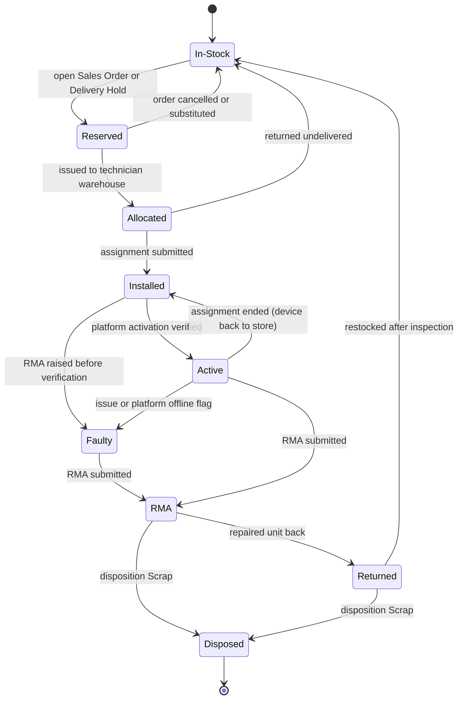
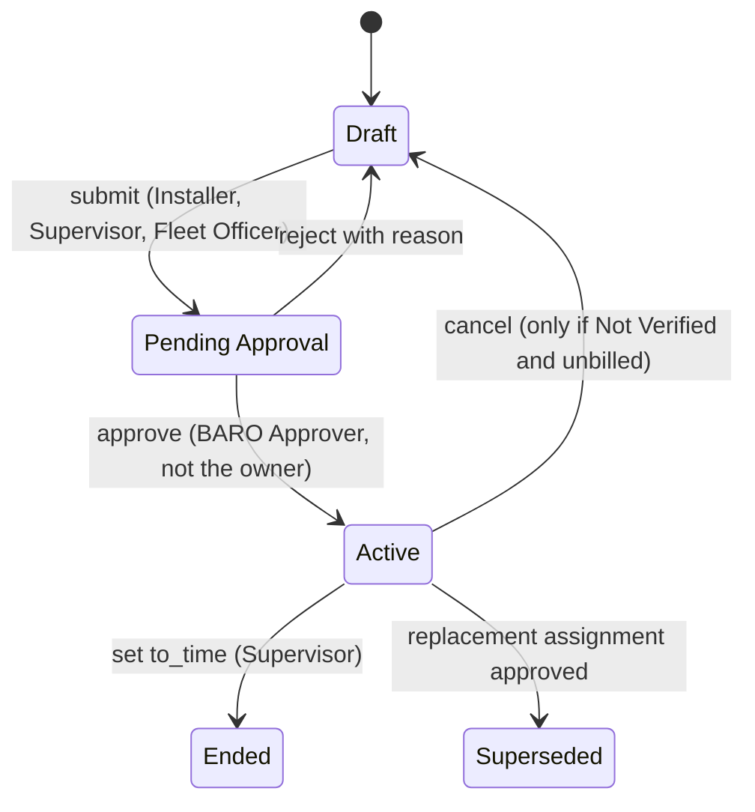
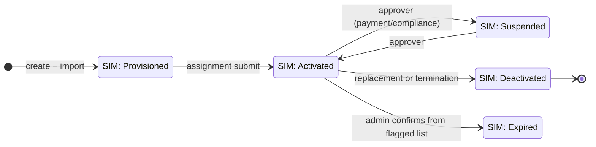
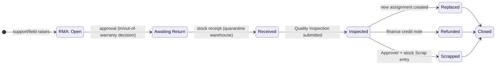

# 40 — Workflows, Approvals and Automation Boundaries

State names here are exactly the enum values in `10-data-dictionary.md` §6. Diagram aliases (e.g. `PA`) exist only because Mermaid cannot use spaces in state identifiers; the legend maps them back.

## 1. The governing rule: detection is not action

BARO's own invariant, carried through this whole design:

> An automated job may **detect, flag, notify and create draft work**. It may not **submit, cancel, suspend, reprice or terminate** anything.

Every transition that changes a customer's service or a ledger amount is executed by a named human through a Workflow transition. This is why §7's scheduler table has no column for "document created as submitted".

Consequences a reviewer should hold us to:
- An overdue invoice never switches tracking off. It raises an exception for `BARO Finance Approver`.
- A device that stops reporting never opens a submitted ticket. It raises a draft `Issue` or a notification.
- A SIM that reaches expiry is flagged, not set to `Expired` (`21` §3).

## 2. Mechanism selection

| Need | Mechanism | Why this and not the alternative |
|---|---|---|
| Role-gated, auditable transition between named states, with notification on entry | **Workflow** (document action) | Gives transition-level role checks, state history, `allow_guest_to_view`, transition emails, and a UI a supervisor can use without training. Property Setters cannot gate transitions; Server Scripts have no transition metadata |
| Hard invariants (uniqueness, overlap, consistency) | **Controller Python** (`validate`, `before_submit`) + DB indexes | Must run on every path (UI, import, API, connector). Workflow actions can be bypassed by an import; a `validate` cannot |
| Cross-DocType side effects | **`doc_events` in `hooks.py`** | Central, version-controlled, testable; keeps ERPNext records (`Serial No`, `Installation Note`) responding without touching their files |
| Field visibility / read-only / defaults / list config | **Property Setter** | Upgrade-safe, no code, ships as a fixture |
| Enum values, mandatory-ness, search indexes | **DocType JSON** (BARO docs) / **Custom Field** (standard docs) | Structural, not cosmetic |
| Cosmetic UX (auto-fill a label, hide a button, warn before leaving) | **Client Script** | **Non-enforcing.** Every client script in this app must carry the comment `# cosmetic only` so nobody mistakes it for control |
| Alerts and scheduled reports | **Notification** records + `scheduler_events` | Declarative, i18n-able, visible to admins |
| Prototypes before the app ships | **Server Script** (doctype event) | Allowed only as a labelled prototype with an exit plan; production rules live in the app so they are versioned, reviewed and testable |

Rule of thumb applied throughout: **Workflow for "who may move this record", Python for "what must be true", Property Setter for "what may be seen".**

## 3. Device lifecycle (`Serial No.baro_device_status`)

| Transition | Written by | Guard | Side effect |
|---|---|---|---|
| In-Stock ↔ Reserved ↔ Allocated | `BARO Stock Manager`, or scheduler flag for Reserved | stock must be available | none |
| Allocated → Installed | `Baro Device Assignment.before_submit/on_submit` | overlap + uniqueness (`31`) | device linked to vehicle/customer |
| Installed → Active | connector `activation verified`, or `BARO Service Supervisor` | `baro_activation_status = Verified` **and** `baro_quality_inspection` set | enables the billing-ready signal |
| → Faulty / RMA | `BARO Support Agent` + RMA submit | no duplicate open RMA (`21` §6) | quarantine warehouse hint |
| RMA → Returned/Disposed | disposition transition on `Baro Device RMA` | `Scrap` needs `BARO Approver` | stock entry required for Scrap/Restock |
| Active → Installed (ending) | assignment `on_update_after_submit` | overlap re-check | clears UQ-DRV keys |

Reserved is a *hint derived from an open order*, never a lock that double-books: two orders can both show interest, and only the assignment step enforces exclusivity (`01` §2.1).

## 4. Device Assignment — the approval-bearing document

| Transition | Workflow condition | Action | Notification |
|---|---|---|---|
| Draft → Pending Approval | `baro_status = Draft`, docstatus 0, all §5 guards pass | runs `31` §5 overlap check, sets keys | supervisor sees it in the Approval Inbox |
| Pending Approval → Active | approver role **and** `owner != login user` | status `Active`, device `Installed`, vehicle/SIM derived fields, activation `Task` created | installer + customer contact (SMS/email template, later) |
| Pending Approval → Draft | any approver | clears approval note | maker sees reason |
| Active → Ended | `to_time` provided and ≥ last `from_time` | clears UQ-DRV keys, device → Installed/Returned, vehicle current pointers cleared | fleet officer |
| Active → Superseded | paired replacement assignment exists | writes `baro_replaced_by` / `baro_previous_assignment` | service supervisor |
| Active → (cancelled) | `baro_activation_status = Not Verified` **and** no submitted Installation Note **and** no invoice consumed it | full derived revert | audit note mandatory |

**Amendment** creates a new document linked by `amended_from`; the old one keeps its history. Amendment of an Active assignment must pass the overlap check again (`31` §8 T-7).

## 5. Other state machines (summary)

`Baro Vehicle`: `Registered → In-Service` is derived (assignment submit); `→ Transferred` requires ending the active assignment plus an approved owner change; `→ Retired` requires no active assignment and an approver. No workflow on the vehicle itself — it is a master whose *transitions of consequence* happen on assignment and RMA documents.

`Baro Platform Mapping` and `Baro Integration Log`: **no workflow by design** — reference and log records the connector must be able to write freely. A workflow here would stall synchronisation behind an approval queue.

`Baro Reconciliation Exception`: one workflow, and it gates exactly one transition — `Open`/`Acknowledged` → `Waived`, allowed only for `BARO Approver` with `baro_waive_reason` filled. Every other status change (`Acknowledged`, `In Progress`, `Resolved`) is a plain role-checked write, because a data-quality finding that requires two approvals to close is a finding nobody closes. The bot may never enter `Resolved` or `Waived` at all (`41` §2 `◊`, `51` §7). The full state machine, auto-clear rules and the platform-down circuit breaker are in `51-reconciliation-exception-design.md` §6–§8.

## 6. Maker-checker

| Control | Implementation |
|---|---|
| Creator ≠ approver | Workflow transition condition `doc.owner != frappe.session.user` **plus** a server check in the transition handler. The condition alone is not enough because a System Manager can edit workflows; the Python check is the authority |
| Approver authority is bounded | `BARO Approver` for operations, `BARO Finance Approver` for money-affecting changes; a discount or suspension needs the finance role even if an ops approver exists |
| Override requires a reason | Warranty override (`21` §6), plate/VIN edit, cancellation — all mandatory `baro_notes` text, `track_changes` on |
| No self-service for secrets | Password fields readable only by System Manager/Connectivity Admin; an approver cannot read a PIN to approve a swap |
| Emergency path | `BARO System Manager` may force a transition only with a reason logged; every forced transition appears in the daily audit report |

## 7. Automated jobs and their strict limits

Full trigger mapping is in `60-automation-trigger-catalog.md`. The contract here:

| Job may | Job may not |
|---|---|
| Read documents and compute a flag field or a report row | Submit, cancel or amend a business document |
| Send email/SMS notifications to a defined recipient | Change billing, suspend service, dispose an asset |
| Create a **draft** `Task`, `Issue` or `Baro Device RMA` | Approve anything |
| Upsert `Baro Platform Mapping`, `Baro Firmware History`, `Baro Integration Log` | Edit derived business keys directly (`30` §7) |
| Recompute derived pointers after a migrate (audit) | Repair a rule violation by deleting history |

## 8. Notification design

| Trigger point | Channel | Recipient | Content rule |
|---|---|---|---|
| Assignment enters Pending Approval | in-app + email | approvers with the vehicle's branch | link the document; never include IMEI in the subject (PII/location sensitivity) |
| Activation not verified within `baro_activation_sla_days` | in-app | installer + supervisor | draft `Task` exists already; this is the escalation |
| Device silent > `baro_inactive_threshold_hours` | in-app + optional SMS | support queue | flagged, never auto-submitted |
| Contract/plan within `baro_expiry_notice_days` | email | account manager (`Customer.account_manager`) | per-customer digest, not per-vehicle spam |
| Certificate (speed limiter/registration/insurance) within `baro_cert_notice_days` | email | fleet officer + compliance | the compliance workspace later reuses this |
| Stock below reorder | email | `baro_reorder_notice_role` | standard ERPNext reorder report as the source |
| Integration row reaches `Dead` | email | system managers | names the platform, endpoint, correlation id |
| Reconciliation mismatch | in-app exception list | fleet + finance | `51` |

Notification records are fixtures (`30` §8), conditional on the state entry, and their templates are translatable (`30` §13).

## 9. What must be true before these workflows are configured

1. Roles from `41` exist (a Workflow referencing a missing role silently allows nobody or everybody depending on version).
2. The enum values in `10` §6 are identical between DocType `options` and Workflow states — `80` checks this.
3. `allow_submit`/`allow_cancel` come from **permissions**, not the workflow (`41` §4), so an import path cannot gain submit rights it shouldn't have.
4. Each workflow's transitions are covered by the `20` §9 UAT scenarios.
5. Staging dry-run of §7.2 pre-flight passes on imported production data before go-live.
