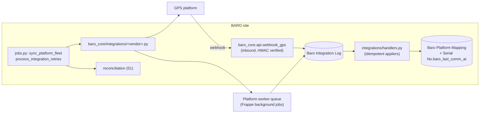
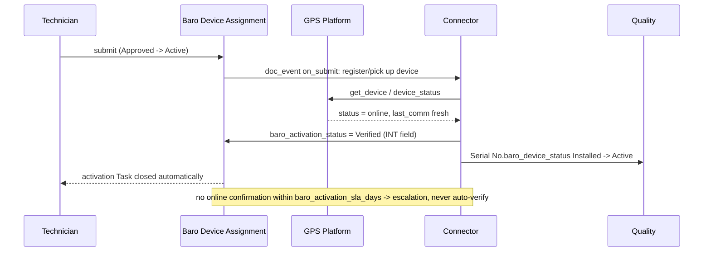

# 50 — Integration Contract: GPS Tracking Platforms

Covers step 8 of the 11-step journey (`01` §2.1): "Integration: verify GPS platform activation". The connector is the only BARO component that talks to an external fleet system, and the only one allowed to write the `INT` fields in `30` §7.

## 1. Boundary

| Syncs | Does not sync |
|---|---|
| Device identity and platform device id | Any track point, speed, ignition or canbus sample |
| Online/offline/moved/stolen state, as an enum | Raw event streams |
| Last communication timestamp (one datetime) | Communication history series |
| Firmware version (discrete values) | Diagnostic logs |
| SIM/ICCID association where the platform knows it | Data-usage time series (aggregates only, later phase) |
| Group/account ids for routing | Anything customer-personal beyond what BARO already holds |

Rule: **a sync may store one value per concept, never a series.** If a requirement needs history, it belongs in the platform or a time-series store, and ERPNext gets the derived state. This keeps backups, restores and reconciliation fast (`01` §5).

## 2. Topology



Two directions, one log, one identity store (`Baro Platform Mapping`). The connector never writes a business document as submitted — it writes reference state and, at most, drafts (`40` §7).

## 3. Platform client contract

Every vendor adapter implements this; no BARO code outside `integrations/` may know a vendor's URL shape.

```python
class PlatformClient:                    # baro_core/integrations/base.py
    def health(self) -> HealthResult: ...
    def list_devices(self, cursor=None, limit=500) -> Page[PlatformDevice]: ...
    def get_device(self, platform_device_id) -> PlatformDevice: ...
    def device_status(self, platform_device_ids: list[str]) -> list[DeviceStatus]: ...
    def last_communication(self, platform_device_ids) -> list[CommStamp]: ...
    def register_device(self, imei, group_id, metadata) -> str: ...     # returns platform id
    def release_device(self, platform_device_id) -> None: ...
    def verify_signature(self, headers, body) -> bool: ...              # inbound HMAC
```

`PlatformDevice` = `{platform_device_id, imei, serial_hint, group_id, status, firmware, last_comm_at, raw_ref}`. Anything richer is rejected at this boundary — the adapter's job is to *reduce* the platform's model to these fields.

Adapters are chosen per `Baro GPS Platform` row via `baro_adapter_module` (`10` §4.8) — a dotted path resolved at runtime, so a platform can be enabled, disabled or added without a code change beyond writing the adapter itself (`21` §8).

## 4. Idempotency

### 4.1 Keys

| Direction | Key derivation | Where stored |
|---|---|---|
| Inbound webhook | `sha256(platform + event_type + platform_event_id or normalised payload)` | `Baro Integration Log.baro_idempotency_key` (UQ) |
| Inbound without a platform event id | `sha256(platform + endpoint + device_id + status + minute_bucket)` — a minute bucket tolerates duplicate pushes of the same state without collapsing genuinely distinct events | same |
| Outbound call | `{doctype}:{name}:{operation}:{attempt_class}` — `attempt_class` is `initial` or `repair`, so a deliberate re-drive is distinguishable from a retry | same |

### 4.2 Contract

1. Write the log row **first**, with `baro_log_status = Received`. If the unique insert raises, the event is a replay: return the previously stored outcome (`baro_result_ref`) and mark it observed, applying nothing.
2. Apply the side effect inside the same transaction as the status flip to `Processed`.
3. If the effect fails, keep the row as `Failed`/`Retrying` with `baro_error_class` — never delete it.
4. Every handler must be safe to run twice for the same key even if the log were lost: upserts keyed on natural identity, never blind `INSERT`. The log is the fast path; identity is the backstop.

Consequence BARO gets: no duplicate invoices from a replayed activation event, no duplicate device assignments from a re-sent install webhook — which the blueprint names as the reason for idempotency in the first place.

## 5. Inbound handling (webhook)

| Step | Behaviour |
|---|---|
| 1 Transport | HTTPS only; reject non-POST; fixed content-type; body size cap |
| 2 Authenticity | HMAC over raw body with `Baro GPS Platform.baro_webhook_secret`; compare in constant time; failure → HTTP 401 + log row **without** payload body (only headers hash) |
| 3 Rate | per-platform limiter (§6) — over-limit responses are 429 so the platform retries rather than the site degrading |
| 4 Envelope | parse into a normalised event; unknown `event_type` → `Received` + `Processed (ignored)`, never an exception (an unknown event must not look like an outage) |
| 5 Idempotency | §4 |
| 6 Resolve | `platform_device_id` → `Baro Platform Mapping` (via PK format, §7 of `21`); unmapped device → create exception `Mapping missing` (`51`) rather than auto-creating a serial |
| 7 Apply | update `baro_platform_status`, `baro_last_comm_at`, `baro_last_sync_at`; recompute `Serial No.baro_last_comm_at` as the max over enabled mappings; if the device was `Installed` and status becomes `Online` with `baro_activation_status` still `Not Verified` → set `Verified` and allow the assignment to reach Active-verified |
| 8 Respond | 2xx as soon as the row is durably recorded; slow work (reconciliation, notifications) goes to the queue |

**Ordering and clocks:** events may arrive out of order. Every state write is guarded by `baro_last_comm_at` monotonicity — an event whose source timestamp is older than the stored value updates nothing but is still logged. Timestamps from platforms are stored in site time zone with the source offset recorded in the payload file; comparisons happen in UTC. Never trust a platform clock for assignment windows — `from_time`/`to_time` are BARO's business facts (`31` §5).

## 6. Rate limiting and concurrency

| Control | Implementation |
|---|---|
| Per-platform outbound budget | token bucket in Redis keyed `baro:rl:{platform}`, capacity = `baro_rate_limit_per_min`, refill per second. A job that would exceed the budget re-queues with `next_retry_at` instead of hammering |
| Concurrency | one in-flight worker batch per platform, guarded by a named lock `baro:sync:{platform}`, so the hourly poller and a manual "sync now" button cannot interleave |
| Batch size | `list_devices(cursor, limit=500)`; `device_status()` called in chunks sized to the platform's documented max |
| Backpressure | if the retry queue depth exceeds a threshold, the sync job pauses and raises an alert rather than growing the backlog |
| Timeouts | `baro_timeout_secs` per call; retries count against the budget |

Values come from `Baro GPS Platform` because official limits differ per vendor (Q2).

## 7. Outbound, retries and dead letters

```
attempt n fails  ->  baro_attempt_count += 1
                     next_retry_at = now + min(base * 2^n, cap)   (base 60s, cap 6h, jitter)
                     status = Retrying
baro_attempt_count >= baro_max_attempts  ->  status = Dead + alert to System Manager
```

| Class | Retry? | Notes |
|---|---|---|
| `Timeout`, `Server` | yes | normal exponential path |
| `RateLimit` | yes, but respect `Retry-After` when the platform supplies it | counted as a soft failure, not a defect |
| `Auth` | **no auto retry** — dead immediately + alert | a wrong key does not fix itself; retrying burns quota and hides the outage |
| `Payload` | no retry — dead + exception | the fix is code or master data, not patience |
| `Unknown` | limited retries then dead | never infinite |

The poller (`process_integration_retries`, every 5 min) claims rows with a conditional update under a lock (`… where baro_log_status='Retrying' and baro_next_retry_at <= now() limit N`) so two workers cannot double-send (`31` §6). Dead rows are re-driveable only by `BARO System Manager`, which writes a new `attempt_class = repair` row rather than editing history, and appears in the forced-action audit report (`40` §6).

## 8. Field mapping (ERP ⇄ platform)

| Concept | ERP side | Platform side | Direction | Rule |
|---|---|---|---|---|
| Device identity | `Serial No.name` | device sn / imei | both | match on IMEI first, serial hint second; ambiguity → exception |
| Platform id | `Baro Platform Mapping.platform_device_id` | device id | in + out | PK format guarantees per-platform uniqueness |
| Online state | `baro_platform_status` | status / last seen | in | enum-mapped per vendor adapter |
| Last comm | `Serial No.baro_last_comm_at` (max) | `last_communications_at` | in | monotonic guard (§5) |
| Firmware | `Baro Firmware History.baro_firmware_version` | firmware version | in | new value → append history row with `baro_update_source = Platform Sync` |
| Group / account | `Customer.baro_platform_customer_ref`, `Baro Vehicle.baro_plate_no` | group id / plate | both | plate is BARO-authoritative outbound; never overwrite BARO's plate from the platform |
| SIM | `Baro SIM Card.baro_iccid` | iccid | out (in for verification) | mismatch → `Mapping missing` exception |
| Activation | `Baro Device Assignment.baro_activation_status` | first online after install | in | drives `Installed → Active` (`40` §3) |

**Authoritative-direction rule** (the thing that prevents a sync war): for each concept, exactly one side owns the truth. Business facts (who owns what, which plate, assignment windows, billing) are BARO-authoritative and only flow outbound. Observed device facts (online, last comm, firmware) are platform-authoritative and only flow inbound. A vendor adapter that wants to write a BARO-authoritative field is a defect, not a feature.

## 9. Activation verification (what the spine waits for)



Failure paths: device never reports → `Failed` + draft `Issue`; reports under a different platform id → mapping exception; device already online because it was pre-configured elsewhere → duplicate-active check (`31` U-6) still blocks a second assignment.

## 10. Monitoring, health and alerts

| Signal | Source | Alert threshold |
|---|---|---|
| Platform health / auth valid | `health()` on the poller | 2 consecutive failures |
| Sync freshness | max `baro_last_sync_at` per platform | older than 2 × pull interval |
| Queue backlog | count of `Retrying` rows | > 200 or oldest > 30 min |
| Dead letters | count of `Dead` rows | > 0 |
| Payload parse failures | `baro_error_class = Payload` rate | > 5/hour |
| Unmapped devices | `Mapping missing` exceptions | > 10/day |
| Ghost/duplicate fleet counts | reconciliation (`51`) | any count mismatch |

Exposed as a `BARO - Integration Health` report and a scheduled digest to `BARO System Manager`. The blueprint's "synchronization monitoring" requirement is this table plus the log — nothing else.

## 11. Log retention and hygiene

- Rows older than `baro_log_retention_days` (default 90) in states `Processed`/`Resolved` are exported to `File` as a compressed archive then purged by the weekly `archive_integration_logs` job. `Dead` and `Failed` rows are **never** auto-purged — they are evidence.
- Payloads are stored as private `File` attachments, stripped of `Authorization`/key headers before storage, truncated above a size cap, with the hash retained (`21` §7).
- No personal location data in the log body: presence metadata only.

## 12. Testing contract

| Test | Assertion |
|---|---|
| replay | same key twice → one side effect, second returns stored result |
| out-of-order | older `last_comm` after newer → no regression |
| unknown event | 2xx, `Processed (ignored)`, no traceback |
| HMAC failure | 401, log row without body, no state change |
| auth dead | `Auth` class → immediately Dead + alert, no retry storm |
| rate limit | `RateLimit` respects `Retry-After` and stays under `baro_rate_limit_per_min` |
| unmapped device | exception created, no auto-serial |
| concurrent poller + manual sync | lock prevents interleaved duplicate writes |
| contract stub | each vendor adapter tested against a recorded fixture (no live platform in CI) |
| reconciliation diff | seeded ERP-only / platform-only / mismatch fixtures produce the expected buckets (`51` §4) |

## 13. What BARO must answer before this is buildable

Q2 in `70-open-questions-stakeholders.md`: platform vendors, auth model (key/HMAC/OAuth2), documented rate limits and batch endpoints, webhook vs polling availability, event schema and whether event ids exist for idempotency, historical depth for the first fleet sync, and a sandbox for adapter development. Until answered, §3's interface and §5–§8's semantics hold — only the enum maps and limits stay vendor-specific.
