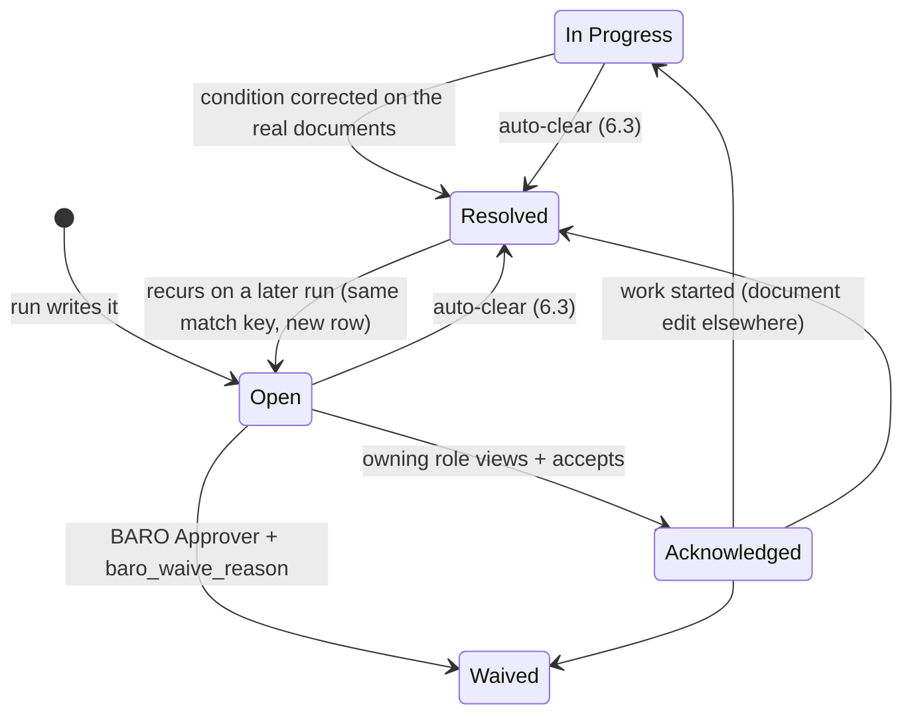

# 51 — Reconciliation & Exception Design

Release-1 slice: **the asset spine reconciles against the tracking platform, and mismatches become assigned, closable work items.** Nothing in this document changes service state, bills a customer, or moves stock. That boundary is inherited from `40-workflows-approvals.md` §1 ("detection is not action") and is the reason this document exists as its own design rather than a set of `if` statements in a scheduler job.

The blueprint asked for four things under "Smart Reconciliation" and "Revenue assurance and billing": compare ERP vehicles, subscriptions and tracking-platform objects; detect unbilled active vehicles; detect subscriptions billed after termination; find ERP-vs-platform fleet count mismatches, expired contracts and overdue payments. All five land here, in two families: **sync reconciliation** (§4) and **revenue assurance** (§5).

---

## 1. What is compared — the three sides

| Side | Source of truth | Exact read |
|---|---|---|
| **A — ERP intent** | `Baro Device Assignment` with `docstatus = 1` and `baro_status = Active` | `serial_no`, `baro_vehicle`, `customer`, `from_time` |
| **B — ERP↔platform bridge** | `Baro Platform Mapping` (enabled platform only — `Baro GPS Platform.baro_enabled = 1`) | `baro_platform`, `platform_device_id`, `serial_no`, `baro_sync_status`, `baro_last_comm_at` |
| **C — Platform reality** | `PlatformClient.list_devices(page)` → `PlatformDevice` (`50` §3) | `platform_device_id`, `imei`, `serial_hint`, `status`, `last_comm_at` |

Two structural facts make the diff meaningful:

- **A is the only side that expresses a customer relationship.** The platform knows a device is transmitting; it does not know who pays for it. So `ERP-only` is not automatically "wrong" — it usually means "not yet registered on the platform", which is a legitimate in-flight state with a grace rule (§4.4).
- **B is the join key by construction** (`50` §1, `11` R-10): the mapping PK is `{platform}-{platform_device_id}`, so a platform id that resolves to a mapping row is *by definition* one BARO device per platform. The diff never fuzzy-matches on IMEI; IMEI is only used to detect that two mapping rows claim the same device (§4.5, `Duplicate active device`).

**Snapshot rule.** Each run reads C once into a bounded in-memory set (streamed, page by page, never materialising telemetry), records `baro_run_id`, and diffs against A and B **as of run start**. Editing a document mid-run must not produce a partial bucket — the run's row count is decided at start, and rows written after that point belong to the next run. `[verify-vs-v16]` Frappe's default `READ COMMITTED`-ish behaviour means this is an application-level rule, not a transaction guarantee; §8 covers the concurrency consequence.

---

## 2. The run

| Property | Decision |
|---|---|
| Trigger | `scheduler_events` daily by default, cadence from `Baro Operations Settings.baro_reconciliation_cron` (`Hourly` / `Daily` / `Weekly`) — the value is *config*, this document is *behaviour* |
| Identity | `baro_run_id = {platform}:{yyyyMMddHHmmss}Z:{short_hash}` — human-parseable, sortable, and enough to group rows without a parent DocType |
| Lock | `frappe.cache().lock("baro:recon:<platform>", expiry=run_timeout)` — one run per platform; a second attempt returns "already running" rather than queueing (`31` §5.2) |
| As user | `BARO Integrator` (bot). It can Create/Write `Baro Reconciliation Exception` and nothing else in this flow (`41` §2 `◊`) |
| Bound | one page-streamed pass per platform; hard cap `baro_max_rows_per_run` (default 20 000 compared devices); if the platform reports more, the run processes the cap, sets `Count mismatch` on the remainder, and logs `truncated` |
| Cost guard | the diff reads only the columns in §1. No telemetry, no track points, no per-device API call — the whole pass is O(pages), not O(devices) |
| Time semantics | everything compared in UTC (`50` §5); a run's `baro_detected_at` is the run start, not the row write time |

Manual entry point: `BARO - Fleet Reconciliation` report page offers "Run now" per platform, restricted to `BARO System Manager` + `BARO Integrator` roles, and it writes the same `baro_run_id`-shaped rows — there is exactly one implementation of the diff, and the button and the cron call it.

---

## 3. Why a dedicated DocType instead of `Issue`

Considered and rejected: creating a Frappe/ERPNext `Issue` for every mismatch (it has SLA fields, an inbox, assignment, and customers already understand it). Rejected for three reasons, recorded here because it will be re-proposed:

1. **Volume and provenance.** A mid-sized fleet diff can produce hundreds of rows per run. `Issue` is a queue measured by first-response and resolution time; filling it with machine-generated data-quality rows destroys the SLA signal for real customer complaints.
2. **Audience.** `Issue` is the customer-facing support record (`03` row 13). A `Billing mismatch` row is internal accounting truth-in-making and must not be visible to a portal user, which means adding a "hidden from customer" special case to a standard doctype — exactly the kind of exception that comes back later.
3. **Semantics.** An exception is *evidence that two systems disagree*, not a *customer problem*. Most rows close without a customer ever being affected. Only a row a human escalates becomes an `Issue`, and that escalation is an explicit, permissioned act (§7).

The exception DocType is defined in `10-data-dictionary.md` §4.10; its field-level rationale is not repeated here.

---

## 4. Sync reconciliation buckets

Each bucket is one `baro_exception_type` value, one predicate, one owning role. Predicates are written as reviewable pseudo-SQL, not implementation SQL.

### 4.1 `ERP-only`
```
A.serial_no NOT IN (SELECT B.serial_no FROM mapping B WHERE B.baro_platform = P AND B.baro_enabled)
```
The ERP believes the device is serving a customer; platform P has never heard of it.
- Owner: `BARO Service Supervisor`.
- Not immediately a fault: a device assigned today legitimately appears on the platform after its first boot. **Grace rule:** a row is suppressed while `now - A.from_time < baro_activation_sla_days` (`Baro Operations Settings`, same value the activation `Task` uses in `21` §2) *and* the assignment's activation Task is still open. Past that, it becomes an exception.
- Revenue implication: none by itself (the customer may be correctly billed for a device the platform dropped). `baro_impact_billable = 0` unless §5.1 also fires.

### 4.2 `Platform-only`
```
C.platform_device_id NOT IN (SELECT B.platform_device_id FROM mapping B WHERE B.baro_platform = P)
```
The platform is receiving from a device ERP does not own. Three real causes, and the exception body must say which it *cannot* distinguish yet: unregistered BARO stock (inventory leak), a device left in a terminated vehicle (service the customer should not be receiving, and presence data BARO has no right to hold), or a stale platform record from a deleted device.
- Owner: `BARO Stock Manager` (it is first an inventory question).
- **Never auto-resolved.** In particular, the run must not auto-create a `Serial No` from `C.imei` — a bot minting inventory records would corrupt stock valuation. `50` §5 step 6 and `41` §5.4 are the same rule seen from the other side.
- `baro_impact_billable = 0` (unbilled by definition — nothing in ERP to bill).

**`Platform-only` vs `Mapping missing` is not a duplication.** They are the same underlying gap seen by two different mechanisms, and keeping them separate is what makes each actionable: `Mapping missing` is raised *event-driven* by the webhook/poller the moment traffic arrives for an unmapped id (`50` §5 step 6) — it is urgent, because a live device is transmitting under no owner. `Platform-only` is raised *run-driven* from the full device listing — it catches devices that are registered on the platform but silent, so no event ever arrives to trigger the other bucket. The `baro_match_key` dedup rule (§6.1) means the second mechanism does not re-open a row the first one already has open for the same platform id, because both write `platform_device_id` into the key.

### 4.3 `State mismatch`
```
A.baro_status = Active AND B.baro_platform_status = Unknown
A.baro_status = Active AND B.baro_last_comm_at < now - baro_inactive_threshold_hours
B.baro_platform_status IN (Stolen, Moved) AND assignment.customer is unchanged
```
Both systems know the device; they disagree about what is happening to it. The `Stolen`/`Moved` case is the one that matters commercially and legally: the ERP still shows a paying customer relationship while the platform flags the vehicle as moved or stolen.
- Owner: `BARO Service Supervisor`; `Stolen` additionally notifies `BARO Approver` and `customer`-side contact per policy — notification only, never automatic suspension (`40` §1 consequence 2).
- `baro_impact_billable = 1` where the mismatch could mean service was not delivered while billing continued.

### 4.4 `Count mismatch`
Per-customer aggregate rather than per-device: `count(A by customer)` vs `count(B+C by customer/group_id)`.
- This is the row a manager actually reads. A single device in `ERP-only` is a task; 37 devices counted short for one customer is a contract conversation.
- Owner: `BARO Approver` when the delta is ≥ `baro_count_alert_threshold` (a number in `Baro Operations Settings`, default 5), otherwise `BARO Service Supervisor`.
- Only written when the run completed without truncation or a platform error (§8) — an incomplete pass proves nothing.

### 4.5 `Duplicate active device`
```
two mapping rows B1 ≠ B2 with B1.serial_no = B2.serial_no AND both platforms enabled
OR B.imei resolves to a serial that has an Active assignment while C reports the same imei under a second platform_device_id
```
Two platform objects claiming one physical device, which is the mechanism by which a customer can be billed twice or a device escapes the UQ-DRV invariant (`31` U-6). This bucket is the only one that can indicate a **bug rather than drift**; its `Details` must carry both platform ids and both last-comm values.
- Owner: `BARO System Manager` (a duplicate here may mean the connector lost its idempotency assumption).
- Never waived by a business role; `Waived` on this type requires `BARO Approver` + `baro_waive_reason` naming the accepted risk.

---

## 5. Revenue assurance checks

These read ERP against ERP (plus the platform only where noted). Same DocType, `ref_doctype` pointing at the financial record.

| # | Check | Predicate (informal) | Bucket | Owner | Billable |
|---|---|---|---|---|---|
| RA-1 | **Unbilled active vehicle** | `Baro Device Assignment` submitted `Active`, customer has no `Subscription` with a `plan` covering it, and the vehicle is not `Retired` | `Billing mismatch` | `BARO Accounts User` | yes |
| RA-2 | **Billed after termination** | `Sales Invoice` with `due_date` (or `posting_date`) after the assignment's `to_time` / the `Contract` `end_date` | `Billing mismatch` | `BARO Accounts User` | yes |
| RA-3 | **Subscription without an asset** | `Subscription` `Active` but zero active assignments for the party (the reverse of RA-1: paying for nothing) | `Billing mismatch` | `BARO Accounts User` | yes |
| RA-4 | **Expired contract still serving** | `Contract.status = Expired` or `end_date < today` while an `Active` assignment exists for that customer | `Billing mismatch` | `BARO Sales Officer` → `BARO Approver` | yes |
| RA-5 | **Overdue beyond policy** | `Sales Invoice.outstanding_amount > 0` and overdue days > the policy figure held on the Subscription/Customer | `Billing mismatch` | `BARO Accounts User`; *suspension* remains a separate approved act | no |
| RA-6 | **Plan/price drift** | Active assignment's vehicle count vs `Subscription Plan` pricing basis disagree (per-vehicle plan with fewer vehicles than billed units) | `Billing mismatch` | `BARO Finance Approver` | yes |

Rules that apply to the whole family:

- **Release-1 scope note.** RA-1…RA-3 need only tables that exist in release 1 (Assignment, Vehicle, Subscription + its `baro_service_level` custom field, Sales Invoice, Contract), so they ship with the spine. RA-5's threshold depends on credit policy and RA-6 on per-vehicle pricing rules — both are `70-open-questions-stakeholders.md` items; the check is implemented with the threshold read from config, so answering the question later is a settings change, not a code change.
- **A revenue-assurance exception never adjusts an invoice.** It has no link that permits writing to `Sales Invoice`, and `BARO Accounts User` closes it by *acting on the invoice through the normal document*, then recording `baro_resolution_notes`. Credit notes, write-offs and plan changes stay in their own workflows.
- **Financial evidence is preserved.** Rows with `baro_impact_billable = 1` are excluded from the auto-clear sweep (§6.3) and from retention purges (§9), because an auditor asking "when did you know about this unbilled fleet?" needs a dated answer.

---

## 6. Deduplication, ageing and auto-clear

Without these three, the exception table becomes a wall of noise and stops being actionable.

### 6.1 One row per condition, not per run
`baro_match_key = norm(imei) | platform_device_id | plate`, plus a **check id** (§4's bucket label or `RA-n`) — the check id, not the bucket, is what makes rows comparable across mechanisms. Before insert: `frappe.db.exists("Baro Reconciliation Exception", {baro_match_key, baro_status: ["in", ("Open", "Acknowledged", "In Progress")]})` → if found, the existing row is **not** re-created; its `baro_detected_at` stays original (so ageing measures from first sight, not last sight) and `Details` is overwritten with the latest comparison. This is a check-then-write on a low-contention table, so no Redis lock is needed beyond the run lock itself — unlike the assignment path (`31` §5), where the same pattern would be unsafe.

**One deliberate exception to "key includes the check id":** `Mapping missing` and `Platform-only` share the check id `unmapped` for a given `(platform, platform_device_id)`, so an event-driven and a run-driven finding about the same device collapse into one row. When they collapse, `baro_exception_type` on the open row is set to the **more urgent** of the two (`Mapping missing`, because live traffic proves the gap). Two open rows saying "this device is unmapped" — one from the webhook, one from last night's run — would each need closing, and the second close would look like a fix.

### 6.2 Ageing
`baro_detected_at` is immutable. The inbox groups by age: `< 24h`, `1–7d`, `> 7d`, and `> 7d` with `baro_impact_billable = 1` is escalated by notification to `BARO Approver` plus the digest to `BARO System Manager`. Escalation is a notification recipient change only; it does not reassign ownership automatically, because an exception reassigned without a human decision is an exception nobody owns.

### 6.3 Auto-clear
The run collects the `baro_match_key` set it *would* have raised. Any open row whose key is **absent** from that complete set is set `baro_cleared_automatically = 1` and `baro_status = Resolved` with `baro_resolution_notes = "not present in run <id>"`.
Three conditions must hold or the sweep is skipped entirely:
1. the run completed without truncation or platform error (§8) — an incomplete pass cannot prove absence;
2. the row is not `baro_impact_billable = 1`;
3. the row is not `Waived` — a waiver is a human statement, and it stays until a human withdraws it.
Auto-resolved rows keep their full history (`track_changes = 1`), so "the system closed this" is always distinguishable from "a person closed this".

---

## 7. Exception lifecycle



`Resolved → Open` is the most important edge in the diagram: a condition that returns is **not** the same exception, and reusing a closed row would hide the recurrence. The new row links to nothing; the report that matters (§10) counts *repeat offenders by match key*.

Transition controls:

| Transition | Who | Check |
|---|---|---|
| → `Acknowledged`, → `In Progress` | the role in `baro_assigned_role` | server-side role check + `baro_assigned_role` must match the user's role (not a name) |
| → `Resolved` (human) | owning role **or** `BARO System Manager` | `baro_resolution_notes` mandatory; and — if the underlying document is now consistent — the run's predicate re-evaluated at save time rejects a false resolution |
| → `Resolved` (auto) | the run only | §6.3 conditions |
| → `Waived` | `BARO Approver` only | `baro_waive_reason` mandatory; workflow transition, `41` §3 permlevel row |
| `Waived` → reopen | `BARO Approver` | requires re-stating the reason; a waiver never survives a change of `baro_exception_type` |

What no transition may do: create, update, submit or cancel any other DocType. There is deliberately **no `doc_events` entry** on `Baro Reconciliation Exception` (§11 in `30` §10 terms). If a future requirement needs "resolve triggers a credit note", that is a new workflow on the invoice, approved by a human — not a side effect of closing a row here.

Escalate-to-`Issue` is the one outward door and it is explicit: a human with `BARO Support Agent` creates a normal `Issue` referencing the exception in `ref_doctype`/`ref_name`. The exception keeps its own status, so support resolving the ticket does not silently resolve the data-quality finding.

---

## 8. When the platform is down — the circuit breaker

A failed platform read must not be reported as a fleet of mismatches. This is the single most damaging failure mode of a naive reconciliation and it is handled before any bucket logic runs.

| Condition at run start | Behaviour |
|---|---|
| `health()` fails, or first page errors with `Auth` / `Server` | **abort the run**; write no exceptions; run summary → `Baro Integration Log` (`baro_error_class` set, `baro_log_status = Failed`); the §10 alert fires on "reconciliation did not run", which is a different fact from "everything is wrong" |
| Platform responds but `RateLimit` mid-pass | stop at the last complete page, mark the run `truncated`, skip §4.4 `Count mismatch` and the §6.3 auto-clear sweep |
| Platform returns an empty device list for a customer BARO believes has 200 vehicles | treat as suspect, not as truth: `Count mismatch` is written with `Details = "platform reported 0"`, and the sweep is skipped for that customer's keys — 200 new `ERP-only` rows in one run is evidence about the platform, not about the fleet |
| Run exceeds its time/row bound | stop, `truncated`, resume next run from the same `baro_run_id` prefix |

The rule behind the table: **absence of evidence is never evidence of absence.** Only a complete, successful pass is allowed to say "this mismatch is gone" or "these 200 devices are missing".

---

## 9. Retention

| State | Retention |
|---|---|
| `Resolved` (auto-cleared), `baro_impact_billable = 0`, older than `baro_log_retention_days` | archived to `File` (CSV) then purged by the same weekly job that handles integration logs (`30` §11) |
| `Resolved` by a human | kept `2 ×` retention — a human statement is worth keeping longer |
| `baro_impact_billable = 1` | never purged automatically (financial evidence, §5) |
| `Waived` | never purged automatically — a waiver is a standing decision with an author |
| `Open` / `Acknowledged` / `In Progress` | never purged; ageing is the pressure, deletion is not |

Archives are private `File` records with restricted read (`41` §3 pattern) and contain no payloads, no PIN/PUK, no location series.

---

## 10. What people see

| Surface | Content | Audience |
|---|---|---|
| `BARO - Reconciliation Inbox` (list view, default filter `Open` + `Acknowledged`) | type, customer, vehicle/serial, age, billable flag | grouped by `baro_assigned_role`; each role's home view shows only its own queue |
| `BARO - Fleet Reconciliation` (Script Report) | per platform, per customer: A count, B count, C count, delta, open exception count, last good run id | `BARO Approver`, `Service Supervisor`, `System Manager`, `Report Viewer` |
| `BARO - Revenue Assurance` (Script Report) | RA-1…RA-6 rolled up to ETB exposure (`baro_impact_billable` rows joined to the invoice/subscription amounts) | `BARO Accounts User`, `Finance Approver`, management |
| Run digest (daily) | run id, platforms covered, rows created per bucket, auto-cleared count, sweep-skipped reason if any | `System Manager`; a one-line "no mismatches" is deliberately sent, so silence cannot be mistaken for health |
| Device 360 / Customer 360 | the open exceptions referencing that serial/vehicle/customer | whoever can see the device (`41` §5.3) — a technician fixing an installation sees why the platform says `Unknown` |

Script Reports rather than Query Reports: raw SQL would bypass User Permissions and Permission Query Conditions, and a branch manager would see headquarters' fleet (`41` §5, `30` §10).

---

## 11. Acceptance-criteria trace

| Criterion (from the blueprints) | Where this document serves it |
|---|---|
| "No duplicate active IMEI assignments" | §4.5 detects a second platform object for one serial *after the fact*; prevention stays in `31` §3–5. The exception is the net, not the trap |
| "Accurate stock reconciliation" | §4.1/§4.2 keep ERP stock and platform reality from silently diverging; the ERP-side count itself is standard Serial No / stock reports (`20` §A2) |
| "Correct recurring invoices" | §5 RA-1…RA-6, which is where "correct" becomes measurable rather than assumed |
| "Documented synchronization error handling" | §8 (platform down), §2 (idempotent run identity), `50` §7 (retry/dead letters) — the two documents split the concern: `50` handles a failing *event*, this handles a failing *state of agreement* |
| U14 (`20` §9 seeded mismatch) | §4.1 and §4.2 definitions are the test oracle: seeded ERP-only and platform-only fixtures must produce exactly those two buckets, no others |
| `50` §12 "reconciliation diff" test row | §4 predicates + §8 abort rules are the assertions; §8 is the row that catches the naive implementation |

---

## 12. Deferred (explicitly not release 1)

| Item | Why later |
|---|---|
| `Baro Integration Batch` parent DocType | `baro_run_id` groups rows well enough; a parent is only worth its migration cost once runs need their own approvals, attachments or per-run SLAs |
| Auto-healing of `Mapping missing` | tempting, and forbidden: it means a bot creating inventory (`41` §5.4) |
| Telemetry-based reconciliation (e.g. "device silent but vehicle moving") | needs a time-series source, which is out of ERP by design (`01` §5) |
| Cross-platform dedup (same device registered on two vendors' platforms deliberately) | needs a business rule about legitimate multi-platform operation; a `70` question |
| Exception→billing adjustment workflow | requires Finance's approval chain, which is phase 3+ (`01` reading order) |
| Customer-visible reconciliation | the portal (later phase) must never expose `Billing mismatch` rows; if customers ever see any of this, it is a purpose-built, filtered view, not this DocType |

---

*Dependencies: vendors, rate limits and the platform's device/group schema (`70` Q2); the overdue/dunning-and-suspension policy (Q3) and the per-vehicle pricing basis (Q5), which decide RA-5's threshold and RA-6's existence; and the count-alert threshold BARO considers newsworthy (Q14). None of them change §1–§8; they change the numbers in `Baro Operations Settings` and the `ref_doctype` targets in §5.*
